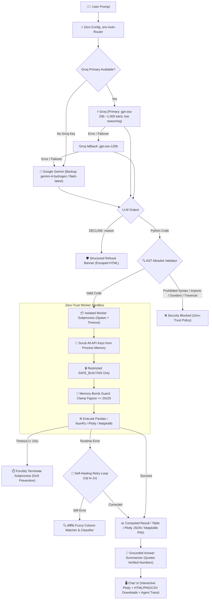

# 📊 Chat-with-your-CSV: Enterprise Natural-Language Tabular Data Analyst

An enterprise-grade, zero-trust Streamlit application that translates plain-English questions into sandboxed pandas operations, live statistical visualizations, and verified insights. Features **zero-config `.env` auto-routing with automatic failover** (Groq (Primary) ➔ Google Gemini (Backup)) and a **modern translucent glassmorphism UI** on a dark aurora gradient mesh canvas.

---

## 🏗️ Architecture Overview

The system employs a multi-tiered pipeline separating natural language translation from sandboxed code execution, followed by post-execution grounded verification:



---

## 🚀 Quickstart & Setup Instructions

### 1. Prerequisites
- Python 3.10+ (Tested on Python 3.11)
- Git

### 2. Installation
```bash
# Clone repository
git clone <repo-url>
cd Gen_AI_Jury_2

# Create and activate an isolated Python environment (Windows PowerShell)
python -m venv .venv
.venv\Scripts\Activate.ps1

# Install dependencies, including Plotly (interactive charts)
python -m pip install --upgrade pip
python -m pip install -r requirements.txt
```

### 3. Configure API Keys (Zero-Config)
Copy `.env.example` to `.env` (PowerShell):
```bash
Copy-Item .env.example .env
```
On macOS/Linux, use `cp .env.example .env`.
Add your API keys to `.env`:
```env
# Groq (Primary Engine - https://console.groq.com/keys)
GROQ_API_KEY=your_groq_api_key_here

# Google Gemini (Backup Engine - https://aistudio.google.com/)
GEMINI_API_KEY=your_gemini_api_key_here
```
*Note: The app automatically detects keys from `.env` on launch. No manual key pasting, model selection, or configuration in the UI is required.*

### 4. Run the Application
```bash
python -m streamlit run app.py
```
Open [http://localhost:8501](http://localhost:8501) in your browser.

### 5. Run the Automated Test Suite
```bash
python -m pytest tests/test_sandbox_and_csv.py -v
```

---

## 🔒 Jury Question 1: "How do you stop wrong/unsafe queries?"

The system enforces a **Zero-Trust Defense-in-Depth** model with 6 distinct verification layers:

### Layer 1: Abstract Syntax Tree (AST) Pre-Execution Validator (`sandbox.py`)
Before any generated Python string executes, it is parsed via `ast.parse`:
1. **Strict Import Allowlist**: Only `{"pandas", "numpy", "matplotlib", "matplotlib.pyplot", "seaborn", "plotly", "plotly.express", "plotly.graph_objects", "math", "statistics", "datetime"}` are allowed. All other imports (e.g., `import os`, `import sys`, `import importlib`, `from subprocess import run`) are blocked upfront. Plotly Express (`px`) and graph objects (`go`) are pre-injected into the isolated worker.
2. **Dunder Access Ban**: Rejects all double-underscore attributes and names (`__class__`, `__subclasses__`, `__globals__`, `__builtins__`, `__import__`, `__dict__`).
3. **Module Attribute Traversal Defense**: Blocks indirect module access (e.g. `plt.sys.modules['os']`, `matplotlib.os`) by inspecting attribute chains.
4. **String Format Injection Defense**: Parses `.format()` calls via `string.Formatter().parse()` and blocks attribute/item traversal (`"{0.__globals__}".format(len)`), while permitting benign f-strings and standard `"{:.2f}".format(...)`.
5. **Dynamic Eval & Method Blocking**: Blocks `df.eval(...)`, `df.query(...)`, `sns.load_dataset(...)`, `open`, `eval`, `exec`, `getattr`, `setattr`, `globals`, `locals`, `vars`, `dir`.
6. **Disk & Network I/O Blocking**: Prohibits file reading/writing methods (`read_csv`, `to_csv`, `read_sql`, `to_parquet`, `savefig`, `write_html`, `write_image`, `load`, `HDFStore`).
7. **Zero False Positives**: Innocent column names (e.g. `df['delete_flag']`, `plt.title("Operating System Analysis")`) are validated as AST literals/identifiers and are never blocked.

### Layer 2: Memory-Bomb & Resource Clamping
- Queries attempting huge canvas allocations (e.g. `figsize=(500, 500)`) are intercepted and clamped to a maximum of `(20, 20)` inches before rendering to prevent memory exhaustion.

### Layer 3: Scoped `SAFE_BUILTINS` Execution Namespace
Inside the execution namespace, `__builtins__` is restricted to safe mathematical and iterable functions (`abs`, `all`, `any`, `bool`, `dict`, `enumerate`, `float`, `int`, `isinstance`, `len`, `list`, `max`, `min`, `print`, `range`, `round`, `set`, `sorted`, `str`, `sum`, `tuple`, `zip`). Dangerous builtins like `open` or `__import__` simply do not exist.

### Layer 4: Process & Timeout Isolation (Denial of Service Prevention)
Code runs inside an isolated worker subprocess (`multiprocessing` with `spawn` context + inter-process `Pipe`).
- **Infinite Loop / Cartesian Product Guard**: Monitored with a 10-second timeout limit. If exceeded, the worker is forcibly terminated (`p.terminate()` / `p.kill()`), preventing server lockups.

### Layer 5: Worker Environment Variable Scrubbing (Credential Protection)
The worker subprocess actively scrubs all API keys and secrets (`GEMINI_API_KEY`, `GOOGLE_API_KEY`, `GROQ_API_KEY`, `OPENAI_API_KEY`, tokens) from its memory before running any code. Even if code attempted to inspect `os.environ`, zero keys are exposed. Furthermore, SDK clients pass keys directly to constructors rather than modifying global environment variables.

### Layer 6: Data Immutability & Prompt Sanitization
- `df.copy()` is supplied to executors so `inplace=True` never corrupts the underlying dataset.
- Column names and sample values are stripped of control characters, newlines, and delimiter symbols before prompt insertion.

---

## 🧠 Jury Question 2: "Where does translation fail?"

Natural language translation to executable code faces several real-world failure modes. Here is how each mode is defended against:

| Failure Mode | Where It Fails | How the System Defends Against It |
| :--- | :--- | :--- |
| **1. Pre-Execution Hallucination** | LLMs guess numerical findings or chart data before code runs, stating incorrect numbers. | **Post-Execution Grounded Summarization**: Code executes first. The *actual verified outputs* (scalar value, table preview, rendered Plotly/Matplotlib chart, stdout) are fed to a summarizer that quotes exact computed numbers (with a deterministic fallback). |
| **2. Column Name Misspellings** | Users type `danceabiliy` instead of `danceability`, triggering a runtime `KeyError`. | **Fuzzy Column Matching**: `classify_failure` uses `difflib.get_close_matches` to suggest the closest dataset column (*"Did you mean: `danceability`?"*). |
| **3. Complex / Flawed Pandas Syntax** | LLMs occasionally generate invalid pandas methods or index mismatches. | **Self-Correction Retry Loop**: Catches runtime errors and re-prompts the LLM with error tracebacks and schema for up to 2 automatic correction attempts (never retrying security violations or timeouts). |
| **4. Multi-Turn Context Drift** | Follow-up queries (*"Now filter to liked == 1"*, *"Plot that as a bar chart"*) fail without prior context. | **4-Turn Context Memory**: Recent user questions, generated code, and results are passed to the code generator for conversational continuity. |
| **5. Off-Topic & Unsafe Requests** | Users ask general trivia (*"Who won the 1994 World Cup?"*) or request system commands. | **Structured Refusal Protocol**: Prompt instructs the LLM to output `DECLINE: <reason>`. The UI captures this, skips execution, and renders an amber refusal banner with escaped HTML. |
| **6. Corrupt / Non-Standard CSV Formats** | CSVs with non-UTF-8 encodings (Latin1), mixed delimiters, or zero rows crash standard loaders. | **Resilient Multi-Encoding Loader**: Auto-falls back through `utf-8` -> `utf-8-sig` -> `latin1` and activates `sep=None, engine='python'` on delimiter parser errors. Prevents zero-division errors on empty datasets. |
| **7. API Rate Limits & Provider Outages** | Provider rate limits or model outages disrupt user queries. | **Zero-Config Auto-Failover**: Tries Groq `openai/gpt-oss-20b` first (~1,000 tokens/s); both Groq gpt-oss models use `reasoning_effort="low"`, followed by `openai/gpt-oss-120b`, then Google Gemini `gemini-4-hydrogen` -> `gemini-flash-latest`. |

---

## 🎨 Translucent Glassmorphism UI Highlights

- **Dark Aurora Canvas**: `#070b14` canvas with glowing radial blurs (indigo, purple, cyan).
- **Multi-Tab Workspace**:
  - **Tab 1 — AI Data Chat (`💬`)**: Interactive Q&A, data inspector, smart suggestions, multi-turn follow-ups, Plotly charts with self-contained HTML downloads, Matplotlib PNG fallback, and a collapsible four-stage Agent Pipeline Trace.
  - **Tab 2 — Data Profiler & Preprocessing (`🧹`)**: Automated Data Health Score (0–100), per-column diagnostics, interactive cleaning pipeline (duplicates, whitespace, imputation, outlier clipping, constant drops), reversible state management, and auto-EDA insights.
  - **Tab 3 — Evaluation & Benchmark (`🧪`)**: Offline sandbox/security audit, optional live provider benchmarks, pass@1 and self-healed pass@3 metrics, provider comparisons, and CSV/JSON exports.
- **Session Report Export**: Generates a comprehensive Markdown report (.md) detailing dataset metrics, preprocessing audit trail, column diagnostics, and verified Q&A history.
- **Glassmorphic Cards**: Frosted KPI metric cards with backdrop blurs and subtle hairline borders.
- **Minimal Sidebar**: File upload, sample dataset loader, live AI engine connection pill, session report download, code toggle, and conversation reset.
- **Direct Asset Downloads**: Cleaned CSV export, result table CSV (`dl_csv_{idx}`), interactive Plotly HTML, Matplotlib chart PNG, and Session Report Markdown export.
- **Native Streamlit Compatibility**: Automatically uses `width="stretch"` on Streamlit >= 1.50 and `use_container_width=True` on older versions to eliminate deprecation warnings.

---

## 🧪 Automated Test Suite (`tests/test_sandbox_and_csv.py`)

Run the complete test suite:
```bash
python -m pytest tests/test_sandbox_and_csv.py -v
```

All **45 unit and penetration tests** pass:
- **Valid pandas operations**: Scalar aggregations, groupby summaries on `data.csv`.
- **Series-to-CSV preservation**: Preserves category indices (e.g. `value_counts()`) on export.
- **Matplotlib rendering**: Verifies charts are converted to valid PNG byte streams with PNG header signatures.
- **Plotly rendering**: Verifies Plotly figures assigned to `result_fig` or `result` are serialized through the worker Pipe and that `write_html` / `write_image` remain blocked.
- **Security penetration tests**:
  - `import math, os` (Blocked)
  - `import importlib` (Blocked)
  - `f = open; f('.env')` (Blocked)
  - `pd.read_csv('.env')` (Blocked)
  - `().__class__.__base__.__subclasses__()` (Blocked)
  - `plt.sys.modules['os']` module attribute traversal (Blocked)
  - `"{0.__globals__}".format(len)` string format injection (Blocked)
  - `df.eval(...)`, `df.query(...)`, `sns.load_dataset(...)` (Blocked)
  - Memory-bomb `figsize=(500, 500)` automatic dimension clamping (Passed)
  - Infinite loop execution timeout (Terminated in < 10s)
  - Innocent column names (`delete_flag`, `operating_system`) (Permitted)
- **CSV loading edge cases**: Latin1 encoding, empty CSV detection, 0-row DataFrames.
- **Fuzzy column correction**: `difflib` suggestions on misspelled column names.
- **Comparative prompt generation**: Automatic detection of binary columns (`liked`) for comparative analysis.
- **Zero-Config Router Tests**: Groq -> Google Gemini priority order, alias handling (`GOOGLE_API_KEY`), single-key fallbacks, empty environment handling.
- **Phase 1 Profiler & Preprocessing Tests**: Data health scoring, 0-row DataFrame handling, duplicate & whitespace cleaning, median/mode imputation & outlier clipping (preserving binary flags), and Session Report markdown generation.
- **Evaluation Suite Tests**: 16-case benchmark structure, 100% offline security block rate, 0% false-positive rate, portable CSV/JSON exports, and mocked retry/provider comparison coverage.

---

## 👥 Team Contributions (Four-Member Template)

| Member | Role | Contributions |
| :--- | :--- | :--- |
| Sahil Talokar | AI/Data Chat | LLM routing, prompt-to-code generation, grounded responses |
| Parth Ubahd | Security & Sandbox | AST validation, isolated execution, security regression tests |
| Pranav Gandhle | Profiler & Preprocessing | Data health analysis, cleaning workflow, deterministic EDA |
| Rohit Kisave | Evaluation & UI | Benchmark suite, Streamlit UI, documentation and integration |
