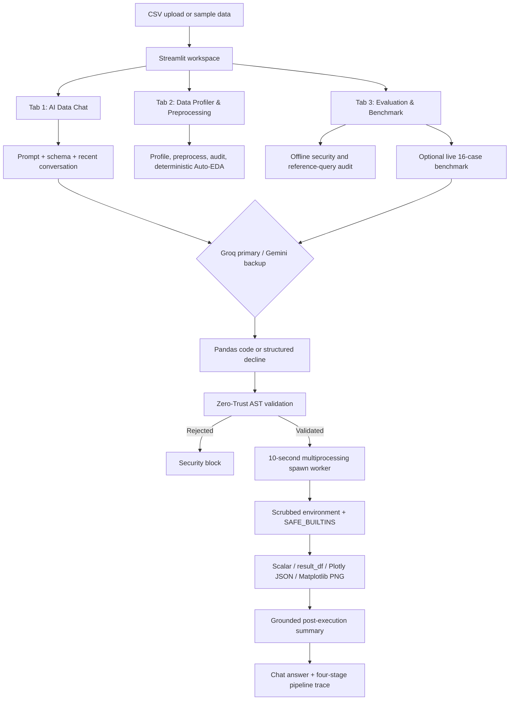

# Chat-with-your-CSV

An enterprise-style Streamlit application for asking natural-language questions about CSV data. It turns prompts into constrained pandas operations, executes them in an isolated zero-trust worker, and grounds summaries in the computed results. The three-tab workspace combines AI Data Chat, Data Profiling & Preprocessing, and Evaluation & Benchmarking.

The private GitHub repository is:

`https://github.com/Parth-349/Chat-with-your-CSV-Enterprise-Natural-Language-Tabular-Data-Analyst.git`

Cloning requires access to the private repository and GitHub authentication configured on your machine.

## Setup

```powershell
git clone https://github.com/Parth-349/Chat-with-your-CSV-Enterprise-Natural-Language-Tabular-Data-Analyst.git
cd Chat-with-your-CSV-Enterprise-Natural-Language-Tabular-Data-Analyst
python -m venv .venv
```

Activate the virtual environment on Windows PowerShell, then install dependencies:

```powershell
.\.venv\Scripts\Activate.ps1
pip install -r requirements.txt
Copy-Item .env.example .env
```

On macOS/Linux, activate with `source .venv/bin/activate` and copy the template with `cp .env.example .env`.

Edit `.env` and add your provider keys:

```env
GROQ_API_KEY=your_groq_api_key
GEMINI_API_KEY=your_gemini_api_key
```

Keep `.env` private; it is ignored by Git. Run the tests and launch the app:

```bash
python -m pytest -v
streamlit run app.py
```

Open [http://localhost:8501](http://localhost:8501). The app can also run without API keys for data profiling and the offline security audit.

## Architecture



### Modules and project files

| File | Responsibility |
| :--- | :--- |
| `app.py` | Three-tab glassmorphism UI in Obsidian-Teal and Champagne-Gold. Automatically routes Groq first (`openai/gpt-oss-120b`, then `openai/gpt-oss-20b`) and Gemini second (`gemini-4-hydrogen`, then `gemini-flash-latest`). Includes four-turn conversation context, self-healing query flow, a four-stage Agent Pipeline Trace, and a post-execution grounded summarizer. Chart-generation prompts guard against 1D heatmaps and require aggregated charts to also return `result_df`. Plotly HTML and Matplotlib PNG exports are supported. |
| `sandbox.py` | Zero-trust AST allowlist for 11 approved library/module names: `pandas`, `numpy`, `matplotlib`, `matplotlib.pyplot`, `seaborn`, `plotly`, `plotly.express`, `plotly.graph_objects`, `math`, `statistics`, and `datetime`. Blocks `os`/`sys` imports and `plt.sys` traversal, disk-writing methods including `write_html`, `write_image`, `write_json`, and `show`, dynamic `df.eval`/`df.query`, and `sns.load_dataset`. The worker also uses a `SafeFormatTransformer` AST rewrite backed by the restricted `_safe_fmt_attr` runtime proxy. Execution uses a 10-second `multiprocessing` spawn worker, `SAFE_BUILTINS`, and environment-secret scrubbing. Includes `difflib` column-name recovery and a multi-encoding CSV loader. |
| `profiler.py` | Data Health Score (0–100), column diagnostics, and a Pandas 3-compatible preprocessing pipeline for `StringDtype` and nullable `Int64`/`Float64`, with an audit trail. Also provides deterministic Auto-EDA insights and Markdown Session Report export. |
| `eval_suite.py` | Offline security/reference-query audit, provider comparison, and a 16-case live benchmark suite with CSV/JSON exports. |
| `tests/test_sandbox_and_csv.py` | 59 automated regression, sandbox-security, profiler, CSV, routing, and evaluation tests. |
| `.streamlit/config.toml` | Dark Obsidian/emerald and champagne theme colors used by the UI. |
| `requirements.txt` | Python runtime and test dependencies, including Streamlit, pandas, Plotly, provider SDKs, and pytest. |
| `data.csv` | Bundled sample dataset: 195 rows × 14 columns. |
| `.env.example` | Template containing `GROQ_API_KEY` and `GEMINI_API_KEY` placeholders. |
| `.gitignore` | Excludes `.env`, Python caches, virtual environments, and test artifacts. |

### Three-tab workspace

1. **AI Data Chat** — Natural-language analysis, multi-turn follow-ups, interactive visual stage, tabular results, downloadable charts, and pipeline telemetry.
2. **Data Profiler & Preprocessing** — Health metrics, column-level diagnostics, duplicate removal, whitespace cleanup, missing-value imputation, IQR handling, and deterministic/AI-assisted insights.
3. **Evaluation & Benchmark** — Offline security and sandbox audit, live fast-subset/full-suite runs, provider comparisons, progress reporting, and downloadable reports.

## Recorded benchmark results

The following results are the measured snapshot recorded on **2026-11-22**. Live-provider latency and availability depend on network conditions, model behavior, and API quotas; these figures are not latency guarantees.

### Unit and regression tests

| Suite | Result |
| :--- | :--- |
| `python -m pytest -v` | **59 / 59 passed (100%)** |

### Offline Sandbox & Guardrail Audit

| Metric | Recorded result |
| :--- | :--- |
| Security Block Rate | **100.0%** — 4/4 attacks blocked |
| False-Positive Rate | **0.0%** — 0/10 valid or innocent cases blocked |
| Expected recovery error detected | **1/1** |
| Average sandbox latency | **1,333.8 ms** across 15 executed cases |

### Live LLM benchmarks on `data.csv`

| Run | Pass@1 | Self-Healed Pass@3 | Off-topic rejection | Average latency |
| :--- | :--- | :--- | :--- | :--- |
| Groq full suite — `openai/gpt-oss-120b`, low reasoning, 16 cases | **93.75% (15/16)** | **93.75% (15/16)** | **100.0% (1/1)** | **5,578.16 ms** |
| Groq fast subset — 6 queries | **83.33% (5/6)** | **100.0% (6/6)** | **100.0%** | **2,269.29 ms** |
| Auto Router — Groq → Gemini, 6 queries | **83.33% (5/6)** | **100.0% (6/6)** | **100.0%** | **4,411.04 ms** |
| Gemini baseline — `gemini-4-hydrogen`, 6 queries | **66.67%** reported | **33.33%** reported | — | **21,329.74–33,317.45 ms** reported |

The Groq fast subset gained **16.67 percentage points** from Pass@1 to Pass@3. Its 2,269.29 ms average was about **7.4× faster** than the 16,699.76 ms Gemini run recorded after free-tier quota exhaustion. That quota-exhausted Gemini run reported **0.0%** success at 16,699.76 ms. The Groq full-suite result was paired with a **100% security block rate** and **0% false-positive rate**.

## Jury Q&A defense

### Q1 — How does the application stop unsafe or incorrect queries?

- Generated code is parsed and checked against a strict AST allowlist before execution.
- Imports, dunder traversal, system/module access, dynamic evaluation, and file/network I/O methods are blocked; `write_json`, `write_html`, `write_image`, and `show` are prohibited.
- Code runs on a copied DataFrame in a spawned worker with restricted builtins, environment-secret scrubbing, and a 10-second timeout.
- The worker returns computed scalars, tables, Plotly JSON, or Matplotlib PNG; it cannot save generated charts to disk.
- Offline audit results measure the security suite separately from live provider behavior.

### Q2 — How does the application recover when natural-language translation fails?

- The router tries Groq models first and then Google Gemini models as backups.
- Generated pandas code is checked by the AST validator and executed before any answer is summarized.
- Recoverable runtime errors are returned to the model for up to two self-healing retries; security blocks and timeouts are not retried.
- `difflib` suggests likely column-name corrections for `KeyError`s.
- The grounded summarizer receives verified `result`/`result_df` output and is instructed to report data findings rather than narrate code.
- The Agent Pipeline Trace exposes intent/schema grounding, route and synthesis latency, AST/sandbox execution, retry count, and grounded-summary status.

## Contributions

| Member | Role | Contributions |
| :--- | :--- | :--- |
| Sahil Talokar | AI Data Chat | Routing, prompt-to-code generation, grounded responses, and chat UI |
| Parth Ubahd | Security & Sandbox | AST validation, isolated execution, and security testing |
| Pranav Gandhle | Profiler & Preprocessing | Data health analysis, preprocessing, and deterministic Auto-EDA |
| Rohit Kisave | Evaluation & Integration | Benchmarking, UI integration, testing, and documentation |
